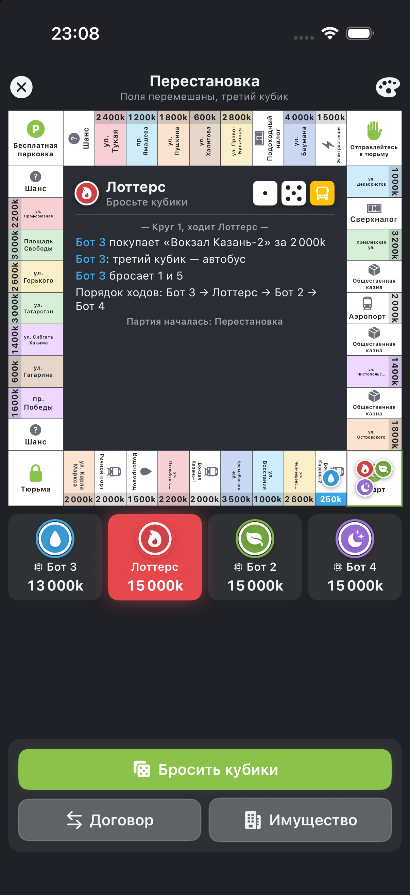

# Tycoon

Оффлайн-Монополия для iPhone: правила в духе Monopoly One на классической доске.
SwiftUI-приложение, боты, режимы «Обычная», «2×2» и «Перестановка», игра по Bluetooth
между iPhone рядом. Игровая логика вынесена в отдельный Swift-пакет `TycoonCore` с тестами.



Улицы, иконки и оформление — свои; к Hasbro и Monopoly One проект отношения не имеет.

## Структура

```
Sources/TycoonCore/
  Random.swift         SplitMix64 с seed, бросок двух кубиков
  Board.swift          типы клеток, цветные группы, «Перестановка» доски
  StandardBoard.swift  классическая доска из 40 клеток
  Cards.swift          колоды «Шанс» и «Общественная казна»
  Models.swift         игроки, настройки, фазы, действия, события, ошибки
  GameState.swift      состояние партии, рента, порядок ходов, публичный вид для ботов
  Engine.swift         apply(действие) — все правила
  Bot.swift            SimpleBot и BotRunner
Sources/TycoonSim/     консольный симулятор баланса
Tests/TycoonCoreTests/ тесты правил
```

Главная идея: состояние меняется только через
`try state.apply(action, by: playerID)`. Функция возвращает список событий
для анимаций. Если действие недопустимо, бросается `GameError`, а состояние
остаётся прежним. UI, боты и Bluetooth лишь создают `Action`.

## Приложение для iPhone (`App/TycoonApp`)

SwiftUI, iOS 17+. Что есть:

- квадратная доска с клетками по периметру, цветные полосы групп смотрят внутрь,
  дома точками, отель звездой, заложенные улицы с замком;
- фишки игроков с анимацией перемещения;
- в центре доски: чей ход, кубики (включая третий), кольцо таймера и подсказка;
- панель игроков: деньги, общая ценность, команда, тюрьма, карточки;
- журнал партии, новые события сверху;
- кнопки действий по фазе хода. Доступность проверяет сам движок на копии партии,
  главное действие подсвечено, нужные клетки на доске мигают;
- окно договора с колонками «Отдаю / Получаю» и индикатором честности;
- карточка улицы (рента, дома, залог) и экран «Имущество»;
- таймер хода: когда время выходит, выполняется безопасное действие по умолчанию;
- hot-seat с экраном «Передайте телефон»;
- 4 скина: «Настолка», «Неон», «Минимал», «Казань». Скин — это структура `Skin`,
  новый добавляется одной записью в `Skin.all`.

### Как открыть в Xcode

Проект уже сгенерирован: открой `App/Tycoon.xcodeproj`, выбери симулятор iPhone и нажми Run (⌘R).
Если добавляешь или переименовываешь файлы, пересоздай проект: `cd App && xcodegen generate`
(настройки лежат в `App/project.yml`).

Отладочный запуск без нажатий: аргументы `-demo classic|teams|reshuffle`, `-skin paper|neon|minimal|kazan`
и `-human` (первый игрок живой, остальные боты). В Xcode они задаются в Product → Scheme → Edit Scheme → Arguments.

## Игра по Bluetooth

На стартовом экране — раздел «По Bluetooth»: один игрок нажимает «Создать комнату»,
остальные на своих iPhone рядом — «Найти комнату рядом». Хост добавляет ботов, выбирает режим
и начинает партию. Работает через MultipeerConnectivity (Bluetooth и Wi-Fi напрямую, интернет не нужен).

- Хост — единственный, кто меняет партию: бросает кубики, водит ботов, считает таймер.
  Остальные телефоны отправляют действия и получают готовое состояние.
- Клиентам уходит копия партии без генератора и порядка колод (`redactedForClients()`),
  поэтому подсмотреть будущие кубики и карточки нельзя.
- Если телефон игрока отключился, за него ходит бот, а когда игрок снова открывает
  «Найти комнату» (или связь восстанавливается сама в течение 30 секунд), он возвращается на своё место.
  Телефон узнаётся по постоянному идентификатору, а не по имени.
  Если отключился хост, у остальных партия заканчивается.

## Сохранение

Партия на одном телефоне сохраняется после каждого действия. На стартовом экране появляется
«Незаконченная партия» с кнопкой «Продолжить». Законченная партия удаляется сама.
Отладка: `-resume` сразу открывает сохранённую партию.

Отладка на двух симуляторах: `-host Имя` (открыть комнату и начать с ботами, как только
кто-то подключится), `-join Имя` (подключиться к первой найденной комнате), `-autoplay`
(за живого игрока на этом телефоне нажимает логика бота).

## Запуск ядра

```bash
cd ~/Tycoon
swift build
swift test --scratch-path /tmp/moon-build   # сборка вне Рабочего стола, иначе macOS мешает подписи тестов
swift run -c release tycoon-sim --games 10000
swift run -c release tycoon-sim --mode reshuffle --games 10000
swift run -c release tycoon-sim --mode 2x2 --games 10000
```

Параметры симулятора: `--mode classic|reshuffle|2x2|2x2-reshuffle`, `--games N`,
`--players 2..6`, `--seed N`, `--rounds N|none`, `--dice random|balanced`.

## Доска

Классическая раскладка: 22 улицы в 8 цветных группах, 4 вокзала (Казань-1,
Казань-2, Речной порт, Аэропорт), Электростанция и Водопровод, по три клетки
«Шанс» и «Общественная казна», подоходный налог и сверхналог, углы Старт,
Тюрьма, Бесплатная парковка и «Отправляйтесь в тюрьму».
Улицы казанские, переименовать их можно в `StandardBoard.swift`.

## Режимы

**Обычный** — `GameSettings.monopolyOne`.

**2×2** — у каждого игрока в `PlayerSetup` задан `team`. Команды ходят
по очереди (A1, B1, A2, B2). Напарники не платят друг другу ренту
(`teammatesPayRent`). Победа — когда соперники обанкротились. При лимите
кругов сравнивается суммарное состояние команд.

**Перестановка** — `GameSettings.reshuffle`. Все клетки, кроме угловых, в начале
партии встают в случайном порядке, а карточки ведут на те же улицы.
Добавляется третий кубик с гранями 1, 2, 3, «автобус», «бонус», «бонус»:
- 1–3 прибавляются к ходу;
- «автобус» — игрок выбирает: идти на первый кубик, на второй или на сумму;
- «бонус» — после хода переход к ближайшей свободной улице, а если свободных нет — к ближайшей чужой;
- тройка (оба кубика и третий совпали) — телепорт на любую клетку.

## Правила

- Ход: два кубика, дубль даёт ещё бросок, три дубля подряд отправляют в тюрьму.
- Проход через Старт даёт +2 000k.
- Покупка улицы, а при отказе — аукцион со всеми игроками (шаг 100k).
- Рента: обычная, ×2 за монополию без построек, 1–4 дома и отель.
  Вокзалы — 250/500/1 000/2 000k, предприятия — сумма кубиков × 40 или × 100.
- Дома строятся и продаются равномерно, продажа за 100% стоимости (как в Monopoly One).
- Залог: 50% цены, выкуп +10%. Если не выкупить за 15 ходов владельца,
  улица уходит банку.
- Тюрьма: штраф 500k, карточка освобождения или 3 попытки выбросить дубль.
- Карточки — колоды из 16 штук, перемешиваются заново, когда заканчиваются.
- Долги: можно продать дома и заложить улицы, иначе банкротство.
  Если кредитор — игрок, он получает улицы должника.
- Договоры: улицы и деньги в обе стороны. Неравные договоры по настройке
  разрешены, помечаются или запрещены. Не больше 3 предложений за ход.
- Конец партии: остался один игрок или одна команда, либо лимит кругов
  (срабатывает в конце полного круга).
- Честность: генератор с seed, случайный порядок ходов, режим «ровных кубиков»,
  гандикап через `PlayerSetup.bonusCash`. Боты видят только `PublicView`.

## Что сверить с Monopoly One

Значения лежат в `GameSettings` (файл `Models.swift`):

- `mortgageTurnLimit` — срок выкупа залога (сейчас 15 ходов);
- `unmortgageFeePercent` — наценка при выкупе (сейчас 10%);
- `maxBuildsPerGroupPerTurn` — «один дом за ход» (сейчас выключено);
- `speedDieFaces` — грани третьего кубика.
